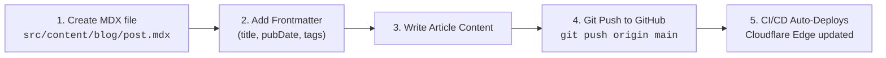

<h1 align="center">
  <br>
  <b>DevOps Engineer Portfolio & Technical Blog</b>
</h1>

<p align="center">
  Personal portfolio website and technical blogging platform of <b>Nguyễn Thanh Quân (QuanBlue)</b>, DevOps Engineer at <b>Viettel</b>.
  <br>
  Built with <b>Astro SSG</b>, styled after a <b>DevOps Network Operations Center (NOC)</b> dashboard, featuring an in-browser <b>Interactive Terminal</b> and zero-cost hosting on <b>GitHub Pages</b>.
</p>

<!-- Badges -->
<p align="center">
  <a href="https://github.com/QuanBlue/portfolio/graphs/contributors">
    
  </a>
  <a href="https://github.com/QuanBlue/portfolio/commits/main">
    
  </a>
  <a href="https://github.com/QuanBlue/portfolio/network/members">
    
  </a>
  <a href="https://github.com/QuanBlue/portfolio/stargazers">
    
  </a>
  <a href="https://github.com/QuanBlue/portfolio/issues/">
    
  </a>
  <a href="https://github.com/QuanBlue/portfolio/blob/main/LICENSE">
    
  </a>
</p>

<p align="center">
  <b>
      <a href="https://quanblue.dev">Live Demo</a> •
      <a href="./docs/custom_domain_setup.md">Documentation</a> •
      <a href="https://github.com/QuanBlue/portfolio/issues/">Report Bug</a> •
      <a href="https://github.com/QuanBlue/portfolio/issues/">Request Feature</a>
  </b>
</p>

<details open>
<summary><b>📖 Table of Contents</b></summary>

- [:star: Project Overview](#star-project-overview)
- [:star: Key features](#star-key-features)
- [🛠️ Technologies](#️-technologies)
- [📁 Folder Structure](#-folder-structure)
- [:toolbox: Getting started](#toolbox-getting-started)
  - [:pushpin: Prerequisites](#pushpin-prerequisites)
  - [:hammer_and_wrench: Run locally](#hammer_and_wrench-run-locally)
- [:computer: Terminal Commands](#computer-terminal-commands)
- [:writing_hand: Technical Blog & Publishing Workflow](#writing_hand-technical-blog--publishing-workflow)
- [:rocket: GitHub Pages Deployment & Custom Domain](#rocket-github-pages-deployment--custom-domain)
- [:white_check_mark: Automated Testing](#white_check_mark-automated-testing)
- [:busts_in_silhouette: Contributors](#busts_in_silhouette-contributors)
- [:scroll: License](#scroll-license)
</details>

---

## :star: Project Overview

Modern cloud infrastructure and distributed systems demand high reliability, automation, and observability. This portfolio showcases real-world DevOps experience, production architecture practices, and technical writing within an interactive dashboard designed like a **Network Operations Center (NOC)**.

The site is statically generated (**Astro SSG**), deployed directly to Cloudflare's global edge network via **Cloudflare Workers Static Assets** on the Free tier ($0/month), backed by automated **GitHub Actions CI/CD**.

---

## :star: Key features

- 🖥️ **DevOps Dashboard UI:** Inspired by APM monitoring consoles (Grafana/Datadog/Jaeger) with CRT scanline effect, dark/light theme switch, real-time telemetry, and APM waterfall trace visualization.
- ⚡ **Interactive In-Browser Terminal:** A fully functional, sandboxed CLI emulator supporting command history (`Arrow Up`/`Down`), prefix autocompletion (`Tab`), typo correction, and mobile virtual keyboards. Runs 100% client-side with zero backend or `eval()`.
- 📝 **Technical Blog Infrastructure:** Built on Astro Content Collections and MDX with Shiki syntax highlighting, table of contents, reading time calculation, and one-click code copy buttons.
- 🛡️ **Zero-Article Safe Build:** Starts cleanly with zero articles; displays an authentic terminal-themed empty state and compiles without build errors.
- 🌐 **Zero-Cost Edge Deployment:** Hosted on Cloudflare Workers Static Assets on the Free Plan ($0/month) with custom domain routing and automated Universal SSL.
- 🔄 **Automated CI/CD Pipeline:** Fully configured GitHub Actions workflow for linting, automated testing, static compilation, and deployment on git push.

---

## 🛠️ Technologies

- **Core Framework:** [Astro](https://astro.build/) (Static Site Generation - SSG)
- **Styling:** [Tailwind CSS](https://tailwindcss.com/) with dark mode and custom CSS variables
- **Content Engine:** [MDX](https://mdxjs.com/) with Astro Content Collections & Zod schema validation
- **Syntax Highlighting:** [Shiki](https://shiki.matsu.io/)
- **Hosting & CDN:** [Cloudflare Workers Static Assets](https://developers.cloudflare.com/workers/static-assets/)
- **Infrastructure as Code / Deployment:** [Wrangler](https://developers.cloudflare.com/workers/wrangler/) & [GitHub Actions](https://github.com/features/actions)
- **Testing:** [Vitest](https://vitest.dev/) (Unit and integration testing)
- **Languages:** TypeScript, Astro, CSS, HTML

---

## 📁 Folder Structure

```text
portfolio/
├── .github/
│   └── workflows/
│       └── deploy.yml              # GitHub Actions CI/CD to Cloudflare
├── docs/
│   └── custom_domain_setup.md      # Custom domain connection instructions
├── src/
│   ├── assets/                     # Static icons and graphic assets
│   ├── components/
│   │   ├── common/
│   │   │   ├── Clock.astro         # Real-time digital clock
│   │   │   ├── Scanline.astro      # CRT monitor scanline visual effect
│   │   │   └── ThemeToggle.astro   # Light/dark theme toggle
│   │   ├── dashboard/
│   │   │   ├── Certifications.astro# Certificates list (CKA, AWS SA)
│   │   │   ├── IdentityCard.astro  # Profile information card
│   │   │   ├── MainViewport.astro  # Experience timeline & tab switcher
│   │   │   ├── ProjectModal.astro  # Detailed project inspect modal
│   │   │   ├── ProjectsList.astro  # Featured deployed services list
│   │   │   ├── SkillsPanel.astro   # Running modules list (Kubernetes, Docker, etc.)
│   │   │   └── TelemetryTrace.astro# Live request counter & APM trace visualizer
│   │   ├── terminal/
│   │   │   ├── InteractiveTerminal.astro # Terminal DOM UI & mobile handlers
│   │   │   └── terminal-engine.ts  # Command dispatcher, history & autocomplete logic
│   │   └── blog/
│   │       ├── BlogCard.astro      # Article card component
│   │       └── BlogEmptyState.astro# Terminal-styled empty state for 0 articles
│   ├── content/
│   │   └── blog/                   # MDX articles directory (initially empty)
│   ├── content.config.ts           # Astro content collection schema
│   ├── data/
│   │   └── portfolio.ts            # Central single source of truth for all data
│   ├── layouts/
│   │   └── BaseLayout.astro        # Base HTML layout shell with SEO & FOUC guard
│   ├── pages/
│   │   ├── 404.astro               # Custom terminal-themed 404 page
│   │   ├── index.astro             # DevOps Dashboard (Homepage)
│   │   └── blog/
│   │       ├── index.astro         # Blog index (renders empty state when 0 posts)
│   │       └── [slug].astro        # Dynamic MDX article route
│   └── styles/
│       └── global.css              # Custom scrollbars, animations, theme tokens
├── tests/
│   ├── portfolio-data.test.ts      # Schema & data authenticity verification
│   ├── reading-time.test.ts        # Reading time calculation tests
│   └── terminal.test.ts            # Vitest suite for all 12 terminal commands
├── wrangler.jsonc                  # Cloudflare Workers Static Assets config
├── astro.config.mjs                # Astro configuration (SSG, MDX, Sitemap)
├── package.json
└── tsconfig.json
```

---

## :toolbox: Getting started

### :pushpin: Prerequisites

- **Node.js:** `>= 20.0.0`
- **npm:** `>= 10.0.0`

### :hammer_and_wrench: Run locally

1. **Clone the repository:**
   ```bash
   git clone https://github.com/QuanBlue/portfolio.git
   ```

2. **Navigate into the directory:**
   ```bash
   cd portfolio
   ```

3. **Install dependencies:**
   ```bash
   npm install
   ```

4. **Start local development server:**
   ```bash
   npm run dev
   ```
   Open [http://localhost:4321](http://localhost:4321) in your browser.

5. **Run automated test suites:**
   ```bash
   npm test
   ```

6. **Build for production (Static SSG):**
   ```bash
   npm run build
   ```
   Generates optimized static assets in the `dist/` directory.

7. **Preview production build locally:**
   ```bash
   npm run preview
   ```

---

## :computer: Terminal Commands

The integrated browser terminal provides an authentic UNIX-like shell experience, strictly bound to the central portfolio data source:

| Command | Action |
| :--- | :--- |
| `help` | Lists all supported commands and usage tips. |
| `whoami` | Displays professional identity and base node. |
| `about` | Displays professional background and engineering philosophy. |
| `skills` | Lists active technical modules and operational competencies. |
| `projects` | Lists featured repositories with production tech stacks. |
| `experience` | Displays career milestones (Viettel, Tech Company XYZ). |
| `contact` | Outputs email, LinkedIn, GitHub, and location coordinates. |
| `github` | Launches the configured GitHub profile in a new browser tab. |
| `blog` | Navigates client-side to `/blog`. |
| `clear` | Clears terminal output history buffer. |
| `history` | Displays list of commands executed during the current session. |
| `neofetch` | Outputs stylized ASCII logo and DevOps system summary. |

---

## :writing_hand: Technical Blog & Publishing Workflow

The blog operates entirely without a database, CMS, or backend server:



### Publishing a new article:
1. Create a new `.mdx` file in `src/content/blog/`:
   ```mdx
   ---
   title: 'High Availability Kubernetes Deployment'
   description: 'Zero-downtime clustering on bare-metal multi-zone infrastructure.'
   pubDate: 2026-11-15
   tags: ['Kubernetes', 'HA', 'DevOps']
   category: 'Architecture'
   draft: false
   ---

   # Your article content here...
   ```
2. Commit and push:
   ```bash
   git add src/content/blog/my-post.mdx
   git commit -m "feat(blog): publish HA Kubernetes article"
   git push origin main
   ```
3. GitHub Actions automatically builds and deploys the new static route `/blog/my-post` in under 60 seconds.

---

## :rocket: GitHub Pages Deployment & Custom Domain

The site is configured for automated deployment to **GitHub Pages** ($0/month):

- **Target Directory:** `dist/`
- **CI/CD Workflow:** [`.github/workflows/deploy.yml`](./.github/workflows/deploy.yml)

### Custom Domain Configuration:
For step-by-step instructions on mapping your existing custom domain to GitHub Pages with free automated HTTPS (via Let's Encrypt), refer to:
👉 **[Custom Domain Setup Guide](./docs/custom_domain_setup.md)**

---

## :white_check_mark: Automated Testing

All terminal commands, prefix autocompletion, command history traversal, and central portfolio data schemas are verified through **Vitest**:

```bash
npm test
```

Output:
```text
 ✓ tests/reading-time.test.ts (3 tests)
 ✓ tests/portfolio-data.test.ts (6 tests)
 ✓ tests/terminal.test.ts (19 tests)

 Test Files  3 passed (3)
      Tests  28 passed (28)
```

---

## :busts_in_silhouette: Contributors

<a href="https://github.com/QuanBlue/portfolio/graphs/contributors">
  
</a>

Contributions, issues, and feature requests are welcome!

---

## :scroll: License

Distributed under the MIT License. See [`LICENSE`](./LICENSE) for more information.
