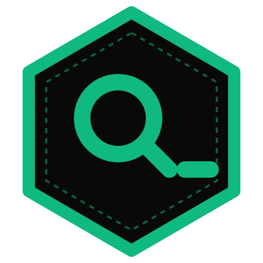
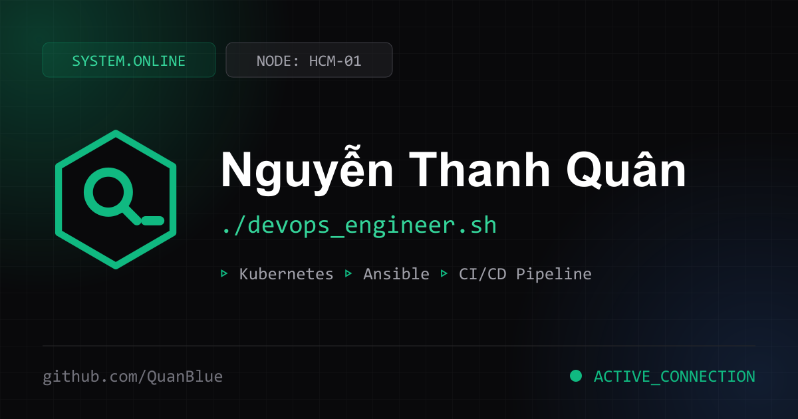
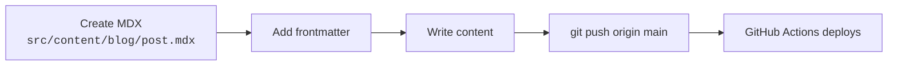

<h1 align="center">
  <br>
  
  <br>
  <b>ntquan<span>_</span>devops</b>
</h1>

<p align="center">
  <code>./devops_engineer.sh</code> — personal portfolio, photo gallery and technical blog of
  <b>Nguyễn Thanh Quân (QuanBlue)</b>, DevOps Engineer at <b>Viettel</b>.
  <br>
  Built with <b>Astro</b>, an in-browser <b>Interactive Terminal</b>, a built-in <b>content editor</b>
  and zero-cost hosting on <b>GitHub Pages</b>.
</p>

<!-- Badges -->
<p align="center">
  <a href="https://github.com/QuanBlue/portfolio/commits/main"></a>
  <a href="https://github.com/QuanBlue/portfolio/stargazers"></a>
  <a href="https://github.com/QuanBlue/portfolio/issues/"></a>
  <a href="./LICENSE"></a>
</p>

<p align="center">
  <b>
    <a href="https://quanblue.dev">Live Demo</a> •
    <a href="./docs/custom_domain_setup.md">Documentation</a> •
    <a href="https://github.com/QuanBlue/portfolio/issues/">Report Bug</a> •
    <a href="https://github.com/QuanBlue/portfolio/issues/">Request Feature</a>
  </b>
</p>

<p align="center">
  
</p>

<details open>
<summary><b>📖 Table of Contents</b></summary>

- [Overview](#overview)
- [Key features](#key-features)
- [Brand identity](#brand-identity)
- [Technologies](#technologies)
- [Folder structure](#folder-structure)
- [Getting started](#getting-started)
- [Managing content](#managing-content)
- [Terminal commands](#terminal-commands)
- [Technical blog](#technical-blog)
- [Deployment](#deployment)
- [Testing](#testing)
- [License](#license)
</details>

---

## Overview

A single scrolling page — **Hero → Gallery → Projects → Experience → Skills → Terminal → Contact** — wrapped in a minimal dark-first design system built around the `ntquan_devops` brand: an emerald hexagon (a node/container) holding a stylised **Q** and a blinking terminal cursor.

The site is statically generated with **Astro** and deployed to **GitHub Pages** through **GitHub Actions**. Nothing runs on a server: content is plain data, edited in the browser and committed to the repo.

---

## Key features

- 🎨 **Brand-driven UI:** emerald `#10B981` on zinc-950, Inter + JetBrains Mono, hex logo, `SYSTEM.ONLINE` / `ACTIVE_CONNECTION` motifs, glass cards, dark/light theme.
- 🖼️ **Photo gallery with network view:** masonry grid; click an image to open a lightbox where **the photo sits in the centre and its metadata (title, date, location, tags, custom info) orbits around it as connected nodes**. Click the photo to zoom, `←`/`→` to navigate, `Esc` to close.
- ✍️ **No hard-coded content:** the `/admin` page edits identity, avatar, gallery, projects, experience, skills and certifications. Images are uploaded, resized and compressed client-side. Changes autosave locally and can be exported to `content.json`.
- ⚡ **Interactive in-browser terminal:** sandboxed CLI emulator with history, `Tab` completion and typo correction. 100% client-side, no `eval()`.
- 📝 **Technical blog:** Astro Content Collections + MDX, Shiki highlighting, table of contents, reading time, code-copy buttons. Builds cleanly with zero articles.
- 🔗 **Social-ready:** `og-image.png` (1200×630) and SVG favicon generated from the brand kit.
- 🔄 **CI/CD:** GitHub Actions workflow builds and deploys on every push.

---

## Brand identity

| Token | Value |
| :--- | :--- |
| Primary — Emerald | `#10B981` |
| Background — Zinc 950 | `#09090B` |
| Panel / stroke — Zinc 800 | `#27272A` |
| Text muted — Zinc 400 | `#A1A1AA` |
| Typefaces | **Inter** (UI, headings) · **JetBrains Mono** (labels, code, terminal) |
| Logo | [`public/logo.svg`](./public/logo.svg) · favicon [`public/favicon.svg`](./public/favicon.svg) |
| Social image | [`public/og-image.svg`](./public/og-image.svg) → `og-image.png` |

The full kit lives in [`docs/brand/brand_identity_kit.html`](./docs/brand/brand_identity_kit.html). Theme tokens are CSS variables at the top of [`src/styles/global.css`](./src/styles/global.css).

To regenerate the PNG after editing the SVG:

```bash
node -e "require('sharp')('public/og-image.svg').png().toFile('public/og-image.png')"
```

---

## Technologies

- **Framework:** [Astro](https://astro.build/) (static site generation)
- **Styling:** [Tailwind CSS](https://tailwindcss.com/) v4 + CSS variables
- **Content:** [MDX](https://mdxjs.com/) with Astro Content Collections
- **Backend (optional):** [Supabase](https://supabase.com) — Postgres + Storage + Auth, secured by RLS
- **Client storage:** IndexedDB (editor drafts)
- **Testing:** [Vitest](https://vitest.dev/)
- **CI/CD & hosting:** GitHub Actions + GitHub Pages

---

## Folder structure

```text
portfolio/
├── .github/workflows/deploy.yml     # Build & deploy to GitHub Pages
├── docs/
│   ├── brand/brand_identity_kit.html
│   └── custom_domain_setup.md
├── public/                          # logo, favicon, og-image
├── src/
│   ├── components/
│   │   ├── common/LiveData.astro    # applies locally saved edits on every page
│   │   ├── dashboard/ProjectModal.astro
│   │   ├── layout/Header.astro
│   │   ├── sections/                # Hero, Gallery, Projects, Experience, Skills, Contact
│   │   ├── terminal/                # Interactive terminal + engine
│   │   └── blog/                    # Blog cards & empty state
│   ├── data/
│   │   ├── portfolio.ts             # Default content + types + merge logic
│   │   └── content.json             # (optional) your exported content, overrides defaults
│   ├── lib/
│   │   ├── render.ts                # Shared HTML renderers (build time + browser)
│   │   ├── store.ts                 # Data loading, drafts, image compression
│   │   ├── supabase.ts              # Supabase client: fetch, publish, upload, auth
│   │   └── lightbox.ts              # Network-style image viewer
│   ├── pages/                       # index, gallery, admin, blog, 404
│   └── styles/global.css            # Design tokens & utilities
├── supabase/schema.sql              # Table, bucket and RLS policies
├── .env.example
├── tests/
├── astro.config.mjs
└── package.json
```

---

## Getting started

**Prerequisites:** Node.js `>= 20`, npm `>= 10`.

```bash
git clone https://github.com/QuanBlue/portfolio.git
cd portfolio
npm install
npm run dev        # http://localhost:4321
```

| Script | Purpose |
| :--- | :--- |
| `npm run dev` | Local dev server |
| `npm test` | Run the Vitest suites |
| `npm run build` | Static build into `dist/` |
| `npm run preview` | Preview the production build |

---

## Managing content

All content is data — no code edits needed. Two modes:

### Mode A — Supabase (recommended): edit online, no redeploy

Content lives in a Supabase Postgres row and images in Supabase Storage. Visitors' browsers fetch it at load time, so changes appear instantly.

1. **Create a project** at [supabase.com](https://supabase.com) (free tier is enough).
2. **Run [`supabase/schema.sql`](./supabase/schema.sql)** in *SQL Editor*. It creates the `portfolio_content` table and a public `portfolio` image bucket, with Row Level Security: **anyone can read, only the owner (`quannguyenthanh558@gmail.com` or GitHub `@QuanBlue`) can write**.
3. **Configure Sign-In (GitHub, Google, and/or Email):**
   - **GitHub OAuth (Repo Owner = ROOT):** *Authentication → Sign In / Providers → GitHub → Enable*, and paste the Client ID & Secret from a [GitHub OAuth App](https://github.com/settings/developers). Signing in as repo owner `@QuanBlue` grants highest (`ROOT`) privilege automatically.
   - **Google OAuth:** *Authentication → Sign In / Providers → Google → Enable*, and add your Google OAuth Client ID & Secret (authorizes `quannguyenthanh558@gmail.com`).
   - **Email (Password or Magic Link):** *Authentication → Users → Add user* (email `quannguyenthanh558@gmail.com` + password).
   - In *Authentication → URL Configuration*, set **Site URL** to your domain and add `http://localhost:4321/admin` + `https://<your-domain>/admin` to **Redirect URLs**.
4. **Add the keys** (*Project Settings → API*):
   - Local: copy [`.env.example`](./.env.example) to `.env` and fill in `PUBLIC_SUPABASE_URL` and `PUBLIC_SUPABASE_ANON_KEY`.
   - GitHub: *Settings → Secrets and variables → Actions → **Variables*** → add the same two names.
5. Open **`/admin`**, sign in with **GitHub**, **Google**, or **Email** (password or magic link), edit, upload images, then press **Publish**.

> [!NOTE]
> The anon key is *meant* to be public; security comes from the RLS function `public.is_portfolio_owner()` in `schema.sql`, which verifies the signed-in JWT email (`quannguyenthanh558@gmail.com`) or GitHub username (`quanblue`). Never put the `service_role` key in this project.

Drafts autosave in your browser until you publish. While the data loads, the page content is briefly hidden (max 4 s) so placeholder data never flashes. If Supabase is unreachable, the site falls back to the built-in data.

### Mode B — No backend: `content.json` through git

Without the env variables, `/admin` runs in local mode:

1. Edit in `/admin` (autosaved in your browser, previewed immediately).
2. **Export content.json**, save it as [`src/data/content.json`](./src/data), commit and push.

`content.json` is merged over the defaults in [`src/data/portfolio.ts`](./src/data/portfolio.ts), so you only need to export what you want to change. Images are embedded in the file (≤1600px JPEG, ~100–300 KB each).

---
## Terminal commands

The terminal reads the same data as the page, including your edits.

| Command | Action |
| :--- | :--- |
| `help` | Lists all supported commands. |
| `whoami` | Professional identity and base node. |
| `about` | Background and engineering philosophy. |
| `skills` | Active technical modules. |
| `projects` | Featured repositories. |
| `experience` | Career milestones. |
| `contact` | Email, LinkedIn, GitHub, location. |
| `github` | Opens the GitHub profile in a new tab. |
| `blog` | Navigates to `/blog`. |
| `clear` | Clears the output. |
| `history` | Commands run in this session. |
| `neofetch` | ASCII logo and system summary. |

---

## Technical blog



```mdx
---
title: 'High Availability Kubernetes Deployment'
description: 'Zero-downtime clustering on bare-metal multi-zone infrastructure.'
pubDate: 2026-11-15
tags: ['Kubernetes', 'HA', 'DevOps']
category: 'Architecture'
draft: false
---

# Your article content here...
```

---

## Deployment

The site deploys to **GitHub Pages** via [`.github/workflows/deploy.yml`](./.github/workflows/deploy.yml) (output: `dist/`). To use your own domain with free HTTPS, follow the [Custom Domain Setup Guide](./docs/custom_domain_setup.md). Set the final URL in `site` inside [`astro.config.mjs`](./astro.config.mjs) so `og:image` and the sitemap resolve correctly.

---

## Testing

```bash
npm test
```

```text
 ✓ tests/reading-time.test.ts (3 tests)
 ✓ tests/portfolio-data.test.ts (6 tests)
 ✓ tests/terminal.test.ts (19 tests)
 ✓ tests/render.test.ts (4 tests)
```

Covers terminal commands, the data model, content merging, HTML escaping and URL sanitising.

---

## License

Distributed under the MIT License. See [`LICENSE`](./LICENSE).
